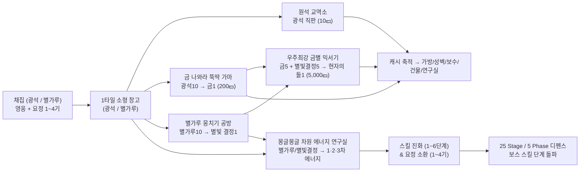

# Fairy Alchemy Tycoon & Defense — 리뉴얼 마스터 기획서 (GDD v2.1 Final)

> **목적**: 본 문서는 전면 개편된 게임의 최상위 기획서이며, 실제 코딩은 하위 4종의 상세 **Guide 문서**를 단일 진실 공급원(Single Source of Truth)으로 삼아 진행한다.

---

## 0. 코딩용 상세 Guide 문서 인덱스

코딩 단계에서는 반드시 아래 4개 Guide 문서의 ID, 수치, 좌표, 규칙을 그대로 구현한다.

1. **자원 가이드**: [01_RESOURCE_GUIDE.md](guides/01_RESOURCE_GUIDE.md) — 캐시, 1~3차 차원 에너지, 광석·별가루·금·별빛 결정·현자의 돌 레시피 및 경제 흐름
2. **건물·창고·요정 가이드**: [02_BUILDING_GUIDE.md](guides/02_BUILDING_GUIDE.md) — 교역소·가마·별가루 뭉치기 공방·믹서기·1타일 창고 4종·몽글몽글 차원 에너지 연구실(Lv.1~5)·요정 4기·성벽 5단계 및 보수
3. **몬스터·웨이브 가이드**: [03_MONSTER_GUIDE.md](guides/03_MONSTER_GUIDE.md) — 25 Stage / 5 Phase 테마(숲속 동물→오크→좀비→뱀파이어→악마), 5분/2분/2분 템포 + 즉시 시작 버튼, 보스 5종 및 스킬 단계 면역 규칙
4. **스킬 진화 가이드**: [04_SKILL_GUIDE.md](guides/04_SKILL_GUIDE.md) — 1~6단계 스킬 진화 트리, 차원 에너지 비용, 3D 시각 이펙트 연출 명세

---

## 1. 핵심 개편 방향 요약 (6대 필러)

| 영역 | 기존 구조 | 리뉴얼 확정 구조 (v2.1) |
|---|---|---|
| **1. 경제/건물** | 8종 원재료 + 9개 공장 + 8종 가공품 | **광석 / 별가루 / 금 / 별빛 결정 / 현자의 돌** 5종으로 압축. 수익원은 **광석 직판(10💵)**, **금 판매(200💵)**, **현자의 돌 판매(5,000💵)** 3종. 생산 건물 4종 + 1타일 창고 4종 근접 배치 |
| **2. 몬스터/전투** | 20 Wave, 10분 대기, 1분 전투 | **25 Stage (5 Phase × 5 Stage)**, 첫 웨이브 **5분 후**, 이후 **2분 휴식(즉시 시작 버튼 지원) / 2분 전투**. Phase별 테마 4종 + **보스 스킬 단계 면역(2~6단계)** |
| **3. 연구소** | 1~4연구소 분산 | 단일 건물 **"몽글몽글 차원 에너지 연구실" (Lv.1~5)** 통폐합. Lv.1~4 별가루 / Lv.5 별빛 결정 투입 → 30초 주기 에너지 생산, 타일 위(생산량/타이머)·아래(적재량) UI |
| **4. 캐릭터/성벽/스킬** | 캐릭터 XP 레벨 + 성소 | **캐릭터 레벨 삭제**. 가방(15→30→50칸), **성벽 5단계(HP 1,000~5,000) + 보수 시스템**, **"스킬 진화" 1~6단계** (Lv.3 달성 시 다음 단계 진화) |
| **5. 플랫폼 UX** | PC/모바일 겸용 | **모바일 세로(Portrait 9:16) 전용** 완전 최적화 (한 손 엄지 조작, 바텀 시트, Safe Area) |
| **6. 비주얼/아트** | 원색 위주 캐주얼 톤 | **럭셔리 아케인 연금술 공방** (딥 네이비·옵시디언 글래스 + 샴페인 골드 + 고급 PBR/블룸 파티클) |

---

## 2. 코어 게임 루프 (Core Loop)

- **전투와 생산의 리듬**: Stage 전투(2분) 동안은 영웅이 동쪽 성문에서 직접 전투를 지휘하고, **휴식 시간(2분, 첫 Stage 5분)** 동안 영웅이 직접 창고의 자원을 꺼내 가마·공방·믹서기·연구실에 투입하며 가공·판매·성벽 보수·스킬 진화를 수행하는 능동적 플레이 루프를 따른다.
- **즉시 시작 옵션**: 휴식 시간이 남았더라도 준비가 끝나면 `⚡ 다음 Stage 즉시 시작` 버튼으로 바로 전투에 돌입해 전체 플레이 템포를 유저가 직접 조절할 수 있다.

---

## 3. 모바일 전용 최적화 설계 (Mobile-Only Portrait UX)

### 3.1 뷰포트 & 화면 비율
- **기준 해상도**: `390 × 844` (9:16 ~ 9:19.5 세로형 스마트폰). 데스크톱 브라우저에서 열더라도 중앙 고정 모바일 프레임(`max-width: 430px`, 9:16 aspect, 배경 딥 다크 처리)으로 렌더링해 모바일 비율과 조작감을 100% 일관되게 유지한다.
- **Safe Area & 터치 차단**:
  - `viewport-fit=cover`, `env(safe-area-inset-top / bottom)` 적용.
  - `touch-action: none`, `user-select: none`, `-webkit-touch-callout: none`으로 스크롤·더블탭 줌·롱프레스 메뉴 완전 차단.

### 3.2 한 손 엄지 조작 & HUD 배치
- **상단 슬림 HUD (높이 ≤ 82px)**:
  - 1줄차: `Stage X / 25 · Phase Y` 배지 + 다음 웨이브/전투 남은 시간 카운트다운 + (휴식 중) **`⚡ 즉시 시작` 미니 버튼** + 성벽 HP 바
  - 2줄차: 보유 재화 4종 슬림 필(Pill) — `💵 캐시` / `🔮 1차` / `💠 2차` / `🌟 3차` (캐릭터 레벨/XP 바는 완전 제거)
- **하단 컨트롤 존 (엄지 반경 내)**:
  - **좌하단~중앙 하단**: 터치 시작 지점에 나타나는 **플로팅 가상 조이스틱**.
  - **우하단 퀵 버튼 (최소 52×52px 원형 글래스 버튼)**:
    1. `✨ 스킬 진화` 버튼 (진화/레벨업 가능 시 골드 펄스 뱃지 표시)
    2. `🏛️ 공방/성벽` 관리 버튼 (가방/건물/연구실/요정/성벽 업그레이드·보수 바텀 시트)
- **바텀 시트(Bottom Sheet) 모달**:
  - 화면 하단에서 올라오는 65% 높이의 반투명 글래스 바텀 시트로 구현하여 한 손 엄지 조작에 최적화.

### 3.3 세로 화면 전용 3D 카메라
- 세로 종횡비(`aspect ≈ 0.46 ~ 0.56`)에 맞춰 수직 FOV `50°~54°`, 영웅 추종 오프셋 약간 북쪽(`z - 1.5`).

---

## 4. 고급스러운 아트 & 비주얼 디렉션 (Luxury Arcane Atelier)

- **UI 베이스**: 딥 미드나잇 옵시디언 (`rgba(12, 16, 30, 0.78)` + `backdrop-filter: blur(16px)`) + 샴페인 골드 테두리 (`#E6C27A` → `#B88A44`).
- **3D PBR & 조명**: 금괴·가마·황금 연성진 메탈릭 광택(`metalness: 0.85, roughness: 0.22`), 별가루·별빛 결정·차원 에너지·현자의 돌 발광 셰이딩, 따뜻한 키 라이트 + 라벤더/인디고 필 라이트.
- **빌보드 UI**: 모든 건물 간판·연구실 타이머·창고 적재 숫자는 얇은 골드 테두리의 다크 글래스 배지로 통일.
